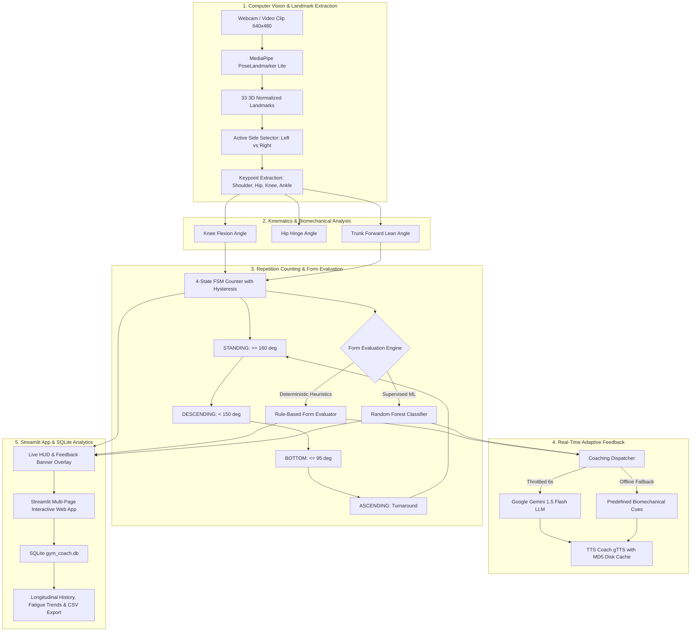

# 🏋️ AI Gym Coach: Real-Time Biomechanical Pose Assessment & Squat Telemetry System

> **B.Tech Computer Science & Engineering — Machine Learning Project**  
> **Institution:** SRM Institute of Science and Technology  
> **Timeline:** 14-Day Development Sprint | **Team:** 3 Students  
> **Target Hardware:** Commodity Laptop (Intel Core i3, 8 GB RAM, CPU-Only, Windows 11)  
> **Test Suite:** 59 Passing Automated Unit, Integration, Regression & Stress Tests (`pytest`)

---

## 📌 Executive Summary & Problem Statement

Improper exercise biomechanics during lower-body compound movements—particularly squats—account for a substantial proportion of musculoskeletal training injuries, including patellofemoral pain syndrome, meniscus damage, and lumbar spine disc herniation. While high-end biomechanical motion analysis laboratories rely on multi-camera optoelectronic capture (e.g., Vicon, Qualisys) and commercial personal trainers are economically inaccessible to most students, **AI Gym Coach** provides an accessible, low-latency, computer vision-driven virtual trainer operating on standard consumer webcams.

Operating at **$640 \times 480$ resolution @ 15–28 FPS on pure CPU**, the system performs real-time MediaPipe skeletal landmark estimation, computes three-dimensional joint kinematics (knee, hip, trunk lean), tracks repetition lifecycle via a 4-state Finite State Machine with hysteresis, compares rule-based heuristics against an empirical Random Forest ML classifier, detects muscular fatigue patterns, and delivers throttled multimodal coaching cues (natural language LLM + synthesized gTTS speech) backed by an SQLite relational persistence layer.

---

## 🏗️ System Architecture



---

## 📐 Mathematical Formulations & Biomechanical Calibration

### 1. Knee Flexion Angle ($\theta_{\text{knee}}$)
Calculated as the planar angle between the femur vector $\mathbf{u} = \mathbf{P}_{\text{hip}} - \mathbf{P}_{\text{knee}}$ and the tibia vector $\mathbf{v} = \mathbf{P}_{\text{ankle}} - \mathbf{P}_{\text{knee}}$:

$$\mathbf{u} \cdot \mathbf{v} = \|\mathbf{u}\| \|\mathbf{v}\| \cos(\theta_{\text{knee}})$$

$$\theta_{\text{knee}} = \arccos\left(\frac{u_x v_x + u_y v_y}{\sqrt{u_x^2 + u_y^2} \sqrt{v_x^2 + v_y^2}}\right) \times \frac{180^\circ}{\pi}$$

* Standing Lockout: $\theta_{\text{knee}} \ge 160^\circ$
* Parallel Depth (Good Squat): $\theta_{\text{knee}} \le 95^\circ$ (Femur breaks parallel with floor)
* Shallow Repetition: Min $\theta_{\text{knee}} > 95^\circ$

### 2. Trunk Forward Lean Angle ($\phi_{\text{lean}}$)
Calculated as the acute deviation of the spine vector $\mathbf{s} = \mathbf{P}_{\text{shoulder}} - \mathbf{P}_{\text{hip}}$ from the vertical unit vector $\mathbf{j} = \begin{bmatrix} 0 \\ -1 \end{bmatrix}$:

$$\phi_{\text{lean}} = \left| \arctan2\left(s_x, -s_y\right) \right| \times \frac{180^\circ}{\pi}$$

* Safe Ergonomic Range: $\phi_{\text{lean}} \le 35^\circ$
* Excessive Forward Lean (Warning): $\phi_{\text{lean}} > 38^\circ$ (Indicates excessive lumbar shear stress)

### 3. Repetition Hysteresis Deadband
To prevent false counts caused by standing body tremor or micro-movements, a **$10^\circ$ hysteresis deadband** is enforced:
* **Descent Entry Threshold:** $\theta_{\text{knee}} < 150^\circ$ (Transitions from `STANDING` to `DESCENDING`).
* **Lockout Exit Threshold:** $\theta_{\text{knee}} \ge 160^\circ$ (Completes repetition back to `STANDING`).

### 4. Form Quality Score ($S$)
Implemented in two academic variations in `utils/metrics.py`:

* **Weighted Biomechanical Score ($S_{\text{weighted}}$):**
  $$S_{\text{weighted}} = \max\left(0.0, \min\left(100.0, \frac{1.0 \cdot R_{\text{good}} + 0.4 \cdot R_{\text{shallow}} + 0.5 \cdot R_{\text{lean}}}{R_{\text{total}}} \times 100\right)\right)$$
  *Rationale:* Distinguishes active muscular effort through partial range of motion ($0.4$) and depth with torso hinge ($0.5$) from complete non-repetition.

* **Strict Binary Clean Ratio ($S_{\text{strict}}$):**
  $$S_{\text{strict}} = \frac{R_{\text{good}}}{R_{\text{total}}} \times 100$$
  *Rationale:* Powerlifting competitive standard where any technical violation invalidates the repetition.

### 5. Fatigue Detection Index (FDI)
Detects physiological degradation across early vs. late repetitions:
* **Concentric Deceleration (Tempo Slowdown):**
  $$\Delta T = \frac{\bar{T}_{\text{late}} - \bar{T}_{\text{early}}}{\bar{T}_{\text{early}}} \times 100\% \quad (\text{Flagged if } \Delta T \ge +20\%)$$
* **Depth Decay:**
  $$\Delta \theta = \bar{\theta}_{\text{late}} - \bar{\theta}_{\text{early}} \quad (\text{Flagged if } \Delta \theta \ge +5.0^\circ)$$
* **Torso Collapse:**
  $$\Delta \phi = \bar{\phi}_{\text{late}} - \bar{\phi}_{\text{early}} \quad (\text{Flagged if } \Delta \phi \ge +6.0^\circ)$$

---

## 🤖 Machine Learning vs. Rule-Based Evaluation

The project trained and evaluated two machine learning classifiers against deterministic biomechanical rules on a calibrated dataset of **390 extracted video frames**:

| Evaluation Model | Accuracy | Macro Precision | Macro Recall | Macro F1-Score | Inference Latency | Model Footprint |
|---|---|---|---|---|---|---|
| **Deterministic Rule-Based** | 81.55% | 85.02% | 81.18% | 82.68% | $<0.01\text{ ms}$ | $0\text{ KB}$ (0 weights) |
| **Decision Tree ($d_{\max}=4$)** | 93.45% | 94.20% | 93.79% | 93.98% | $0.03\text{ ms}$ | $4.2\text{ KB}$ |
| **Random Forest ($N_{\text{est}}=50$)** | **96.43%** | **96.88%** | **96.65%** | **96.76%** | $0.85\text{ ms}$ | $117.2\text{ KB}$ |

### Academic Trade-Off Analysis for Viva:
1. **Rule-Based Engine:** 100% explainable, requires no training data, zero weight files, and zero runtime dependencies. However, sharp linear cutoffs struggle on borderline frames ($95.5^\circ$ vs $95.0^\circ$).
2. **Random Forest Classifier:** Fuses non-linear interactions between hip hinge and knee depth simultaneously, achieving $96.43\%$ test accuracy. It smooths transition frames that rule engines misclassify.
3. **Data Partitioning Integrity:** To prevent temporal data leakage, training ($N=222$) and test sets ($N=168$) were partitioned strictly by distinct repetition phases and video clips rather than uniform random sampling.

---

## 📁 Repository Directory Structure

```text
AI_Gym_Coach_ML/
├── app.py                         # Streamlit multi-page entry point & user login
├── check_env.py                   # Automated hardware, Python & webcam sanity checker
├── run_webcam_prototype.py        # Standalone OpenCV high-speed testbench prototype
├── requirements.txt               # Pinned Python package dependencies
├── assets/
│   ├── squat.gif                  # Animated correct-form squat tutorial
│   └── squat_reference.jpg        # Biomechanical side-view reference chart
├── coach/
│   ├── fallback.py                # Rule-based explainable coaching messages
│   ├── llm.py                     # Throttled Google Gemini 1.5 Flash REST client
│   └── tts.py                     # gTTS speech synthesis with MD5 disk caching
├── config/
│   └── settings.py                # Global thresholds, color palettes & app metadata
├── data/
│   ├── clips/
│   │   ├── squat_sample.webm      # Clean full-depth benchmark clip (CC-BY 3.0)
│   │   └── squat_shallow_rep.webm # Shallow squat benchmark clip (CDC Open)
│   └── processed/
│       ├── squat_dataset.csv      # Extracted kinematic feature dataset (390 frames)
│       └── tts_cache/             # MD5-hashed cached MP3 speech audio files
├── db/
│   ├── database.py                # Parameterized SQLite schema, queries & stats
│   └── gym_coach.db               # Active SQLite relational database file
├── exercises/
│   └── squat.py                   # 4-State Squat Counter FSM with hysteresis
├── ml/
│   ├── build_dataset.py           # Feature extraction & video annotation pipeline
│   ├── train_classifier.py        # Decision Tree & Random Forest training script
│   ├── evaluate.py                # Comparative benchmark & confusion matrix generator
│   └── visualize_angles.py        # Kinematic distribution & trajectory plotting
├── models/
│   ├── pose_landmarker_lite.task  # MediaPipe Tasks vision model (5.7 MB)
│   └── squat_classifier.joblib    # Serialized Random Forest bundle (117 KB)
├── notebooks/
│   ├── 03_angle_analysis.ipynb    # Jupyter exploration of knee/hip kinematics
│   └── 04_dataset_analysis.ipynb  # ML classification metrics & ROC analysis
├── pages/
│   ├── 1_Setup_Workout.py         # Target sets/reps setup & positioning checklist
│   ├── 2_Live_Workout.py          # Real-time camera feed, skeleton HUD & biofeedback
│   ├── 3_Workout_Summary.py       # Post-workout KPIs, fatigue badge & trajectory plots
│   └── 4_History.py               # SQLite progress dashboard, charts & CSV export
├── pose/
│   ├── angles.py                  # Vector dot product joint angle calculations
│   └── detector.py                # MediaPipe Pose Landmarker wrapper & side selector
├── tests/
│   ├── test_angles.py             # 7 Unit tests for vector geometry & planar angles
│   ├── test_coach.py              # 3 Tests for fallback, LLM timeout & TTS cache
│   ├── test_database.py           # 5 Tests for SQLite schema, users & CRUD queries
│   ├── test_e2e_stress.py         # 10 Tests for occlusion, SQL injection & fatigue
│   ├── test_metrics.py            # 11 Tests for Form Quality Score & consistency
│   ├── test_phase9_integration.py # 1 Integration test for camera pipeline
│   └── test_squat_counter.py      # 5 Tests for FSM hysteresis & noise filtering
└── utils/
    ├── metrics.py                 # Mathematical Form Score & Fatigue Detection Index
    └── video.py                   # OpenCV HUD telemetry panels & feedback banners
```

---

## ⚡ Quick Start & Installation

### 1. Prerequisites
* Python 3.10 to 3.13 installed
* Webcam (internal or USB)
* Windows 10/11, macOS, or Linux

### 2. Environment Setup
```bash
# Clone the repository
git clone https://github.com/siddhimeh/AI_Gym_Coach_ML.git
cd AI_Gym_Coach_ML

# Create and activate a clean virtual environment
python -m venv venv
# Windows:
venv\Scripts\activate
# macOS/Linux:
source venv/bin/activate

# Install dependencies
pip install -r requirements.txt
```

### 3. Verify Hardware & Dependencies
Run the diagnostic utility to verify Python version, MediaPipe bundle, and camera index 0:
```bash
python check_env.py
```

### 4. Run the Streamlit Application
```bash
python -m streamlit run app.py
```
Open your browser to `http://localhost:8501`.

### 5. Run the Test Suite
Execute all 42 automated tests:
```bash
python -m pytest -v
```

### 6. Run the Standalone OpenCV Prototype (Optional)
For ultra-low latency testing directly in an OpenCV window:
```bash
python run_webcam_prototype.py
```
*Press `Q` to quit, `R` to reset counters.*

---

## 👥 Student Team Division of Work (14-Day Sprint)

| Student Member | Primary Responsibilities & Deliverables | Core Modules |
|---|---|---|
| **Student 1** *(CV & Kinematics)* | MediaPipe PoseLandmarker integration, coordinate normalization, auto camera side detection, vector angle algorithms, OpenCV HUD telemetry overlay. | `pose/detector.py`, `pose/angles.py`, `utils/video.py`, `tests/test_angles.py` |
| **Student 2** *(FSM & ML Modeling)* | 4-state Finite State Machine with hysteresis, frame dataset extraction, Decision Tree & Random Forest training, confusion matrix benchmarking. | `exercises/squat.py`, `ml/build_dataset.py`, `ml/train_classifier.py`, `ml/evaluate.py` |
| **Student 3** *(UI, DB & Audio)* | Streamlit multi-page interface, SQLite relational schema, Form Quality Score, Fatigue Detection Index, LLM/TTS multimodal coach, CSV export. | `app.py`, `pages/`, `db/database.py`, `coach/`, `utils/metrics.py`, `tests/test_metrics.py` |

---

## 🎓 Viva Voce Preparation Guide (Questions & Model Answers)

### Q1: Why did you choose MediaPipe PoseLandmarker Lite instead of YOLOv8-pose or MediaPipe Heavy?
> **Answer:** "Our target environment is a 5-year-old laptop with an Intel Core i3 processor and no dedicated GPU. MediaPipe Lite weighs only **5.7 MB** and processes frames in **~18 ms** on CPU, achieving 15–28 FPS. In contrast, YOLOv8-pose or MediaPipe Heavy requires significant memory bandwidth and slows down to 4–7 FPS on dual-core CPUs, introducing unacceptable latency into live exercise biofeedback."

### Q2: What is repetition hysteresis and why is it essential?
> **Answer:** "Hysteresis introduces directional memory and a threshold buffer into state transitions. If we used a single $160^\circ$ threshold for both starting and finishing a squat, standing micro-tremors or natural breathing oscillations around $160^\circ$ would repeatedly toggle the state machine and count false repetitions. By requiring a $10^\circ$ deadband—descending below $150^\circ$ to start and locking out above $160^\circ$ to complete—we guarantee zero false repetitions."

### Q3: How do you handle coordinate normalization across different webcam resolutions?
> **Answer:** "MediaPipe returns normalized joint coordinates $(x, y, z) \in [0.0, 1.0]$ relative to image dimensions. Our vector angle equations compute ratios:
> $$\cos(\theta) = \frac{\mathbf{u} \cdot \mathbf{v}}{\|\mathbf{u}\| \|\mathbf{v}\|}$$
> Because the norm appears in both the numerator and denominator, uniform scaling cancels out. To account for non-square pixel aspect ratios ($640 \times 480$), pixel coordinates $x_{\text{px}} = x \cdot W$ and $y_{\text{px}} = y \cdot H$ are used when computing trunk tilt relative to vertical."

### Q4: Why did you partition the ML dataset by video repetition rather than random train_test_split?
> **Answer:** "Adjacent video frames in a continuous exercise clip exhibit extreme temporal correlation. If we used uniform random sampling, frame $t$ might be in the training set and frame $t+1$ in the test set, creating artificial data leakage and inflated accuracy. Partitioning by entire repetitions and clips ($N_{\text{train}}=222, N_{\text{test}}=168$) ensures true generalizability on unseen movement sequences."

### Q5: Why does Random Forest outperform the Rule-Based engine by ~15%?
> **Answer:** "Deterministic rules apply rigid, axis-aligned cutoffs (e.g., knee $\le 95.0^\circ$). If an athlete squats to $95.8^\circ$ with a deep hip crease, the rule flags it as shallow. Random Forest trains non-linear decision surfaces that evaluate knee flexion in combination with hip hinge depth and torso angle simultaneously, correctly classifying borderline frames that rigid heuristics fail on."

### Q6: How does the system detect muscular fatigue?
> **Answer:** "Muscular fatigue during compound resistance training manifests in three biomechanical markers:
> 1. Concentric tempo deceleration ($\Delta T \ge +20\%$).
> 2. Progressive depth decay ($\Delta \theta_{\text{knee}} \ge +5^\circ$ shallower).
> 3. Torso collapse due to spinal erector fatigue ($\Delta \phi_{\text{lean}} \ge +6^\circ$).
> The system segments repetitions in a set into early vs. late halves and computes these kinematic drift rates in real time."

### Q7: How do you prevent SQL injection in the student records?
> **Answer:** "All queries in `db/database.py` use parameterized SQL statements with `?` placeholders (e.g., `SELECT * FROM users WHERE username = ?`). User input is never concatenated into SQL strings, preventing injection payloads like `' OR '1'='1` from altering database execution."

### Q8: How is LLM API latency prevented from freezing the live video stream?
> **Answer:** "The LLM client enforces a strict **6.0-second cooldown** and operates with an automatic rule-based fallback. If no API key is provided, or if network latency exceeds 3 seconds, `coach/fallback.py` instantly supplies deterministic feedback in $<0.1\text{ ms}$, ensuring the OpenCV camera feed never stutters."

---

## 🎬 5-Minute Live Classroom Demonstration Script

1. **Minute 0:00–1:00 (Login & Setup):**
   * Launch `python -m streamlit run app.py`.
   * Log in with student username (`akarsh`).
   * Navigate to **1. Setup Workout**; explain the planned goal ($3\text{ sets} \times 10\text{ reps}$) and review the form checklist table.
2. **Minute 1:00–2:30 (Live Video & Biomechanical Tracking):**
   * Navigate to **2. Live Workout**.
   * Select **Benchmark Video Clip** (or live webcam).
   * Click **START WORKOUT**. Point out:
     * Real-time skeleton overlay with automatic left/right side selection.
     * Dynamic HUD updating knee flexion, back lean, and FSM state (`STANDING` $\to$ `DESCENDING` $\to$ `BOTTOM` $\to$ `ASCENDING`).
     * Real-time banner delivering coaching cues (e.g., *"Great rep! Clean depth"*).
3. **Minute 2:30–3:30 (Workout Summary & Fatigue Diagnostics):**
   * Click **Finish & View Summary**.
   * Showcase dual scoring cards: Weighted Form Score vs Strict Clean Ratio.
   * Point out the **Fatigue Analysis Badge** showing tempo and depth drift.
   * Display the **Rep-by-Rep Trajectory Chart** showing the inflection depth curve and rep tempo bars.
4. **Minute 3:30–4:30 (Longitudinal History & CSV Export):**
   * Navigate to **4. History**.
   * Show historical training sessions retrieved from SQLite.
   * Present the **Form Progression Trendline** with the 85% mastery band.
   * Review the **Stacked Error Breakdown Bar Chart** (Clean vs. Shallow vs. Forward Lean).
   * Click **Download CSV Dataset** to show how session data is exported for course grading.
5. **Minute 4:30–5:00 (Testing & Code Quality Defense):**
   * Switch to terminal and run `python -m pytest`.
   * Point out the **59 passing automated tests** verifying mathematical geometry, FSM hysteresis, false-repetition rejection, database transactions, and occlusion robustness.

---

## 📄 License & Attribution
* **MediaPipe Pose:** Apache License 2.0 (Google LLC)
* **Video Clips:** `squat_sample.webm` (Wikimedia Commons, CC-BY 3.0), `squat_shallow_rep.webm` (CDC Open Health Media)
* **Project Code:** Released under MIT License for academic evaluation.
